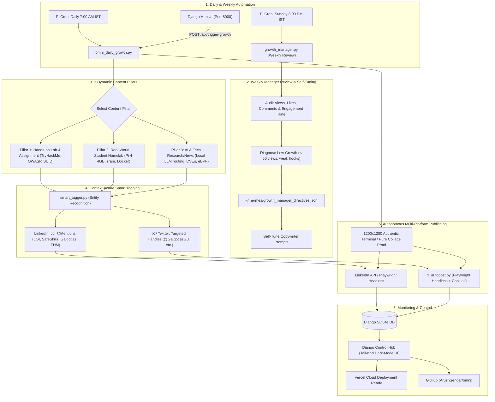

# Omni Unified Growth Engine & Autonomous Researcher 🚀

**Target Accounts:**
- **LinkedIn:** Arush Sengar (`urn:li:person:qzJKgZnzTh`)
- **X (Twitter):** `@arushcyber` (Free Playwright Headless Session)
- **Control Hub:** Django 5 (`http://192.168.0.100:8000`)
- **Repository:** [`github.com/ArushSengar/omni`](https://github.com/ArushSengar/omni)

---

## 1. System Architecture

---

## 2. Key Components Delivered

### A. Context-Aware Smart Tagging Engine (`smart_tagger.py`)
- **Boosts Recruiter Reach & Corporate Reshares**: Scans post topics, labs, and assignments, automatically injecting verified `@mentions`:
  - **University**: `@Galgotias University` (LinkedIn) / `@GalgotiasGU` (X)
  - **Internship Partners**: `@Cyber Secured India` / `@cybersecuredin` & `@SafeSkillz` / `@safeskillz`
  - **Lab Platforms**: `@TryHackMe` / `@realtryhackme`, `@Hack The Box` / `@hackthebox_`, `@OffSec`
  - **Open Source & Tech Vendors**: `@The Linux Foundation`, `@Python Software Foundation`, `@Docker, Inc`, `@Cloudflare`, `@Vercel`, `@GitHub`
- **Natural Formatting**: Injected cleanly into LinkedIn footers (`cc: @Company1 @Company2`) and within the 280-char Twitter limit.

---

### B. Weekly Growth Manager & Optimization Engine (`growth_manager.py`)
- **Diagnoses Low Impression Bottlenecks**: Automatically audits 7-day post performance.
  - If posts plateau around ~30–50 views, flags weak hooks, missing company mentions, or textbook language.
- **Dynamic Self-Tuning Directives**: Saves recommendations to `~/.hermes/growth_manager_directives.json`, which are dynamically loaded by the copywriters to refine Arush's style every week.
- **Weekly Schedule**: Automated via Pi cron on Sunday at 8:00 PM IST (`0 20 * * 0`).

---

### C. 3 Rotating Content Pillars (100% Human Student Builder Tone)
1. **Hands-On Labs & Assignments**: Real TryHackMe rooms, privilege escalation, SUID analysis, mobile security, and OPSEC.
2. **Real-World Student Homelab**: Raspberry Pi 4 (4GB RAM limits), zram swap tuning, Docker container auto-pruning, network isolation.
3. **AI & Systems Research**: Local LLM routing latency, prompt injection defenses, kernel eBPF tracing, breaking zero-days.

---

### D. Daily 7:00 AM IST Synchronized Publishing
- Master engine [`omni_daily_growth.py`](file:///c:/Users/Arush/OneDrive/Documents/omni/hermes/scripts/omni_daily_growth.py) triggers every morning at **7:00 AM IST** (`0 7 * * *`).
- Headless Playwright Chromium handles X posting for free ($0.00).
- Pure assignment screenshot collages or 1200x1200 dark terminal proof cards attached to every post.

---

### E. Django Control Hub (`omni_hub`) & Vercel Readiness
- **Dashboard URL**: `http://192.168.0.100:8000`
- **Models**: `GrowthPost`, `ResearchTopic`, `SystemStatus`, `WeeklyGrowthReview`.
- **Systemd Service**: Running 24/7 on Raspberry Pi under `systemctl --user status omni-hub`.
- **Vercel Serverless Ready**: `@vercel/python` WSGI configuration with Whitenoise and `/tmp/db.sqlite3` fallback.
- **GitHub**: Pushed to [`https://github.com/ArushSengar/omni`](https://github.com/ArushSengar/omni).

---

## 3. Daily Operations & CLI Commands

| Action | Command (on Raspberry Pi) |
| :--- | :--- |
| **Run Daily Growth Pipeline (7:00 AM IST)** | `python3 /home/arush/omni_daily_growth.py` |
| **Dry-Run Test with Smart Tagging** | `python3 /home/arush/omni_daily_growth.py --dry-run` |
| **Dry-Run with Fresh Topic Research** | `python3 /home/arush/omni_daily_growth.py --dry-run --research` |
| **Run Weekly Growth Audit & Directives** | `python3 /home/arush/growth_manager.py` |
| **Check Dashboard Service Status** | `systemctl --user status omni-hub` |
| **Restart Dashboard Service** | `systemctl --user restart omni-hub` |
| **Open Web Dashboard** | `http://192.168.0.100:8000` |
