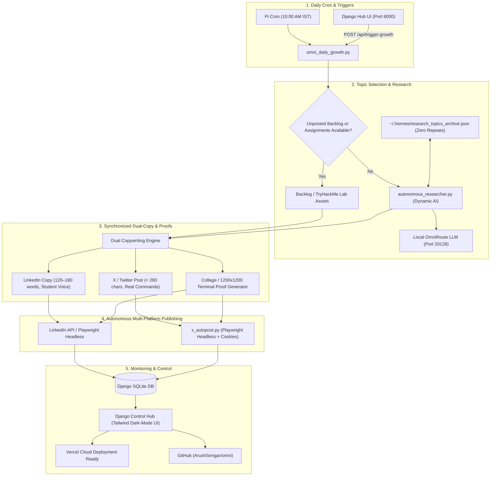

# Omni Unified Growth Engine & Autonomous Researcher 🚀

**Target Accounts:**
- **LinkedIn:** Arush Sengar (`urn:li:person:qzJKgZnzTh`)
- **X (Twitter):** `@arushcyber` (Free Playwright Headless Session)
- **Control Hub:** Django 5 (`http://192.168.0.100:8000`)
- **Repository:** [`github.com/ArushSengar/omni`](https://github.com/ArushSengar/omni)

---

## 1. System Architecture

---

## 2. Key Components Delivered

### A. Autonomous Daily Research Engine (`autonomous_researcher.py`)
- **Never Runs Out of Topics**: When unposted assignments finish, the engine queries the local OmniRoute LLM across 6 engineering domains:
  1. *Cyber Security & Threat Intel* (SUID escalation, eBPF telemetry, memory safety, TLS 1.3 audits)
  2. *Linux Kernel & Memory Architecture* (zram zstd swap, cgroups v2, page cache eviction, OOM tuning)
  3. *Python Internals & High-Performance Dev* (tracemalloc profiling, asyncio starvation, GC tuning)
  4. *Computer Networking & Protocol Internals* (TCP BBR vs Cubic, DNS caching, QUIC migration)
  5. *Databases & Cloud Architecture* (SQLite WAL concurrency, Postgres connection pooling)
  6. *AI Security & Autonomous Agents* (Prompt injection defense, tool sandboxing, latency profiling)
- **Zero Duplicates Guarantee**: Researched topics are logged to `~/.hermes/research_topics_archive.json`. Past topics are automatically injected into the research prompt's exclusion list.

---

### B. 100% Free X (Twitter) Engine (`x_autopost.py` & `x_daily_post.py`)
- **Zero Official API Charges ($0.00)**: Operates headless Playwright Chromium with injected session cookies (`~/.twitter-profile/cookies.json`).
- **Human Voice on #TechTwitter**: Punchy copy under 280 characters with authentic Linux commands, no AI clichés.
- **Backdrop & Focus Bypass**: Dispatches keystrokes via direct textarea focus (`page.keyboard.press("Control+Enter")`) and DOM-level clicks to eliminate Twitter modal backdrop pointer-interception errors.
- **Live Proof Verified**: Successfully posted to `@arushcyber` with live high-res TryHackMe lab collage proof.

---

### C. Django Control Hub (`omni_hub`)
- **Models**:
  - `GrowthPost`: Stores post titles, platform content, metrics (views, likes, comments), URNs, and status.
  - `ResearchTopic`: Dynamic technical topic pool with commands, diagnosis, solution, and tags.
  - `SystemStatus`: Real-time Pi uptime, RAM stats, and OmniRoute health.
- **Dark-Mode Tailwind Dashboard**: View live feeds, trigger growth runs, and monitor status at `http://192.168.0.100:8000`.
- **Systemd Service**: Running 24/7 on Raspberry Pi under `systemctl --user status omni-hub`.

---

### D. Vercel & GitHub Integration
- **GitHub Repository**: [`https://github.com/ArushSengar/omni`](https://github.com/ArushSengar/omni)
- **Vercel Serverless WSGI**:
  - `omni_hub/vercel.json` and `vercel.json` configured with `@vercel/python`.
  - `wsgi.py` exposes `app = application`.
  - Whitenoise configured in `settings.py` for instant CDN static asset serving.
  - Read-only SQLite handling points to `/tmp/db.sqlite3` on Vercel lambda instances.

---

## 3. Daily Operations & CLI Commands

| Action | Command (on Raspberry Pi) |
| :--- | :--- |
| **Run Unified Growth (Full Auto)** | `python3 /home/arush/omni_daily_growth.py` |
| **Dry-Run Test with Research** | `python3 /home/arush/omni_daily_growth.py --dry-run --research` |
| **Post Specific Assignment** | `python3 /home/arush/omni_daily_growth.py --assignment 7` |
| **Check Dashboard Service** | `systemctl --user status omni-hub` |
| **Restart Dashboard Service** | `systemctl --user restart omni-hub` |
| **View Dashboard in Browser** | `http://192.168.0.100:8000` |
