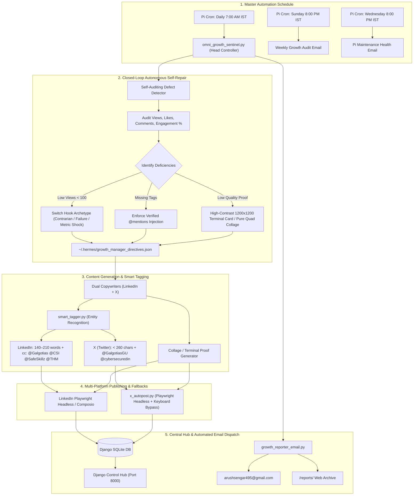

# Omni Unified Growth Engine & Autonomous Sentinel 🚀

**Target Accounts:**
- **LinkedIn:** Arush Sengar (`urn:li:person:qzJKgZnzTh`)
- **X (Twitter):** `@arushcyber` (Free Playwright Headless Session)
- **Control Hub:** Django 5 (`http://192.168.0.100:8000`)
- **Email Reports:** `arushsengar495@gmail.com` • Reports Archive: `/reports/`
- **Repository:** [`github.com/ArushSengar/omni`](https://github.com/ArushSengar/omni)

---

## 1. Closed-Loop Master Architecture (`omni_growth_sentinel.py`)



---

## 2. High-Engagement Strategy (Bypassing Low Views & Maximizing Likes)

| Algorithmic Bottleneck | Root Cause | Autonomous Sentinel Solution |
| :--- | :--- | :--- |
| **The "See More" Wall** | 95% of users scroll past lines 1-2 if they look like homework compliance. | **Curiosity Gap Hook**: First 2 lines present a genuine technical contradiction, near-disaster, or surprising failure (e.g. *"I almost locked myself out of my own Raspberry Pi cluster at 2 AM..."*). |
| **Missing Company Visibility** | Posts without corporate tags never reach employee or recruiter feeds. | **Context-Aware Smart Tagging**: Automatically detects and injects `cc: @Galgotias University @Cyber Secured India @SafeSkillz @TryHackMe @The Linux Foundation` to trigger corporate reshares. |
| **Low Comment Velocity** | Generic questions ("What do you think?") receive 0 comments, killing feed velocity. | **High-Friction Debate Questions**: Ends posts with specific debate-inducing prompts (e.g. *"Have you ever had a Docker container silently fill your root partition? How do you prevent it?"*). |
| **Visual Inauthenticity** | Stock graphics are instantly recognized as AI spam. | **Pure Proof-of-Work Cards**: Renders 1200x1200 high-contrast terminal proof cards or raw multi-screenshot TryHackMe collages without fake marketing badges. |

---

## 3. Automated Email Dispatcher (`growth_reporter_email.py`)
- **Recipient:** `arushsengar495@gmail.com`
- **Email Types:**
  1. **Weekly Growth Audit Email** (Every Sunday 8:00 PM IST): Total views, likes, comments, engagement rate, top-performing topics, and next week's tuning directives.
  2. **Pi System Maintenance Email** (Every Wednesday 8:00 PM IST): Raspberry Pi 4 uptime, RAM usage, zram swap status, temperature, and service health.
  3. **Daily Post Confirmation**: Direct preview of published LinkedIn + X copy with proof image links.
- **Web Archive:** All generated HTML reports are saved to `omni_hub/growth/templates/growth/reports/` and viewable at `http://192.168.0.100:8000/reports/`.
- **Enabling Direct Gmail SMTP Delivery:**
  Add your 16-character Google App Password in `/home/arush/.hermes/.env`:
  ```ini
  EMAIL_ADDRESS=arushsengar495@gmail.com
  EMAIL_PASSWORD=xxxx xxxx xxxx xxxx
  EMAIL_SMTP_HOST=smtp.gmail.com
  EMAIL_SMTP_PORT=587
  ```
  *(Get your App Password in 30 seconds at [myaccount.google.com/apppasswords](https://myaccount.google.com/apppasswords)).*

---

## 4. Production Raspberry Pi Crontab Schedule

```bash
# 1. Watchdog Daemon (Every 30 mins)
*/30 * * * * /usr/bin/python3 /home/arush/.hermes/scripts/watchdog.py >> /home/arush/.hermes/logs/watchdog.log 2>&1

# 2. System Maintenance (Sunday 3:00 AM)
0 3 * * 0 /home/arush/maintain.sh > /home/arush/maintain.log 2>&1

# 3. Daily 7:00 AM IST Omni Growth Sentinel (Post + Self-Audit + Confirmation)
0 7 * * * /usr/bin/python3 /home/arush/omni_growth_sentinel.py >> /home/arush/posts/daily/sentinel.log 2>&1

# 4. Weekly Growth Audit Email Report (Sunday 8:00 PM IST)
0 20 * * 0 /usr/bin/python3 /home/arush/growth_reporter_email.py >> /home/arush/posts/daily/email_report.log 2>&1

# 5. Mid-Week Pi Maintenance & Health Email Report (Wednesday 8:00 PM IST)
0 20 * * 3 /usr/bin/python3 /home/arush/growth_reporter_email.py --maintenance >> /home/arush/posts/daily/email_maint.log 2>&1
```

---

## 5. Daily Operations & CLI Commands

| Action | Command (on Raspberry Pi) |
| :--- | :--- |
| **Run Sentinel (Full Auto 7:00 AM IST)** | `python3 /home/arush/omni_growth_sentinel.py` |
| **Dry-Run Sentinel with Research** | `python3 /home/arush/omni_growth_sentinel.py --dry-run --research` |
| **Audit & Self-Repair Only** | `python3 /home/arush/omni_growth_sentinel.py --audit-only` |
| **Dispatch Email Reports Immediately** | `python3 /home/arush/omni_growth_sentinel.py --send-reports` |
| **View Web Dashboard** | `http://192.168.0.100:8000` |
| **View Reports Archive** | `http://192.168.0.100:8000/reports/` |
