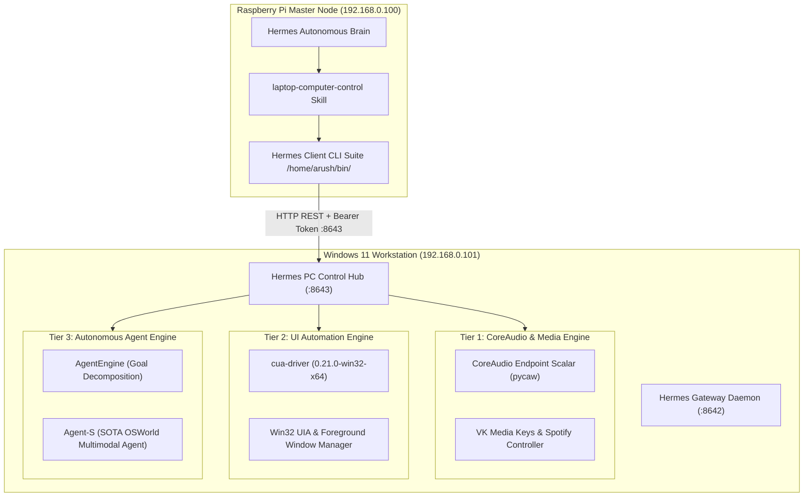

# 💻 Hermes Laptop Worker Node & Master Mesh Setup (Architecture v2.1)

This document records the production architecture and operational connection between the **Raspberry Pi Master Hub (`192.168.0.100`)** and the **Windows 11 Laptop Workstation (`192.168.0.101`)**.

---

## 🏗️ Architecture Overview

---

## ⚡ The 3-Tier Command Suite (Raspberry Pi -> Laptop)

On the Raspberry Pi, Hermes has a complete suite of production CLI tools in `/home/arush/bin/`:

### 🎵 Tier 1: Hardware Audio & Media Transport
| Command | Arguments | Description | Latency |
|---|---|---|---|
| `laptop-volume` | `[0-100]` | Reads or sets exact physical speaker volume scalar via `pycaw`. Guaranteed hardware control. | < 0.05s |
| `laptop-media` | `play\|pause\|next\|prev` | Sends global hardware media keyboard events (`VK_MEDIA_*`). | < 0.02s |
| `laptop-spotify` | `play <track>` | Brings Spotify to foreground, searches track, and triggers playback. | ~2.5s |
| `laptop-spotify` | `queue <track>` | Searches track and adds it directly to the Up Next queue. | ~2.8s |

### 🖥️ Tier 2: UI Automation & Screen State
| Command | Arguments | Description | Latency |
|---|---|---|---|
| `laptop-windows` | *(none)* | Returns a complete list of visible windows with title, PID, and geometry. | < 0.2s |
| `laptop-focus` | `<title_keyword>` | Restores and brings any application to the foreground. | < 0.1s |
| `laptop-screenshot` | *(none)* | Captures active display/window state to disk. | < 0.4s |
| `laptop-click` | `<x> <y> [pid]` | Clicks exact coordinates on screen. | < 0.1s |
| `laptop-type` | `"<text>" [pid]` | Types text directly into the focused window. | < 0.2s |
| `laptop-hotkey` | `<k1> [k2]` | Presses key combinations (e.g. `ctrl a`, `enter`). | < 0.1s |

### 🤖 Tier 3: Autonomous Agent Engine
| Command | Arguments | Description | Latency |
|---|---|---|---|
| `laptop-agent` | `"<natural_language_goal>"` | Parses high-level goals, decomposes into steps, and executes autonomously. | Dynamic |

### 🛠️ System & Telemetry Utilities
| Command | Arguments | Description | Latency |
|---|---|---|---|
| `laptop-status` | *(none)* | Live battery, RAM, CPU load, and session state. | < 0.3s |
| `laptop-speak` | `"<text>"` | Real-time speech synthesis out of laptop speakers. | < 0.5s |
| `laptop-browser` | `"<url>"` | Launches Chrome on laptop screen to specific URL. | < 0.8s |
| `laptop-exec` | `"<command>"` | Runs PowerShell or CLI commands and returns stdout/stderr. | Dynamic |

---

## 🔧 Service & Persistence Configuration

- **Hub Daemon Port**: TCP `8643` (`0.0.0.0`)
- **Hermes Gateway Port**: TCP `8642`
- **Authentication**: Bearer Token `sk-laptop-hermes-token-2026`
- **Persistence (Auto-Start)**:
  - Startup Script: `C:\Users\Arush\AppData\Roaming\Microsoft\Windows\Start Menu\Programs\Startup\Hermes_PC_Hub.vbs`
  - Runs silently in background with `pythonw.exe` on Windows user logon.
- **Pi Skill Definition**: `/home/arush/.hermes/skills/laptop-computer-control/SKILL.md`
