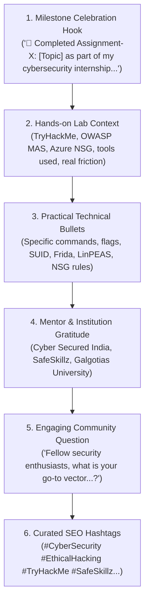

# 🚀 Autonomous LinkedIn Growth & Proof-of-Work Engine (v3.0 God-Mode)

> **Designed for Arush Sengar**  
> *1st-Year BCA Cyber Security Student @ Galgotias University*  
> *Cyber Security Intern @ Cyber Secured India & SafeSkillz*  
> *Homelab Engineer & Builder Learning in Public*

---

## 1. Executive Summary & Root Cause Analysis

### Why Hermes's Previous Posts Were Flawed
1. **The Stock Photo Trap**:
   - `linkedin_daily_card_v2.py` previously queried the **Wikimedia Commons API** with generic keyword queries (`cybersecurity`, `technology`).
   - When matching failed or yielded non-cyber images, it selected museum photos (such as the cutaway diesel engine in post #1) with an arbitrary dark banner overlay.
   - Result: Zero proof of work, zero credibility, disconnected visual imagery, and low engagement (3 likes).
2. **Missing Assignment Pipeline**:
   - `linkedin_activity_detector.py` previously looked for docx files in `~/`, but completed assignment reports were archived in `~/assignments_archive/documents/`. As a result, the detector perceived zero active assignments and fell back to generic backlog prompts.
3. **Sterile, Non-Humanized Copy**:
   - The LLM was prompted to open abruptly without greeting or celebration, omitted mentor recognition, and lacked the authentic student milestone structure that drives community engagement.

---

## 2. The Peer Benchmark: The Kaushik Choubey Winning Formula

Analysis of high-performing posts from classmate & peer **Kaushik Choubey** revealed a consistent 6-part anatomy:



### Visual Proof-of-Work Benchmark:
- **Never Stock Photos**: Every image must feature genuine, verifiable evidence.
- **2x2 Quad Proof Collage**:
  - **Q1 (Top-Left)**: Branded Header Card (Cyber Secured India, SafeSkillz, Galgotias University badges, assignment name, candidate name, verified badge).
  - **Q2 (Top-Right)**: Platform badge or completion card (TryHackMe room completed, points, streak).
  - **Q3 (Bottom-Left)**: Core tool scan / enumeration screenshot (Nmap, Gobuster, LinPEAS).
  - **Q4 (Bottom-Right)**: Exploitation, flag capture, or system configuration proof.
- **Mobile Pentesting Layout**: Top header banner with 3 mobile emulator / runtime hooks side-by-side.
- **Homelab Days**: Live terminal proof card with active systemd status (`omniroute`, `hermes-gateway`, `watchdog`), RAM allocation, and uptime.

---

## 3. Core Engine Architecture

The upgraded architecture consists of four modular components running on the Raspberry Pi 4:

```
/home/arush/
├── linkedin_daily_post.py          <-- Master orchestration & Composio publisher
├── linkedin_activity_detector.py   <-- Assignment parser, DOCX extractor & rotation
├── linkedin_copywriter.py          <-- OmniRoute LLM humanized copywriting engine
├── linkedin_collage_generator.py   <-- Pillow-based 1200x1200 proof-of-work collage renderer
└── assignment_media/               <-- High-resolution extracted assignment screenshots
```

### Component Breakdown

| Component | File | Responsibilities |
| :--- | :--- | :--- |
| **Detector** | [`linkedin_activity_detector.py`](file:///c:/Users/Arush/OneDrive/Documents/omni/hermes/scripts/linkedin_activity_detector.py) | Scans `~/assignments_archive/documents/*.docx` and `~/*.docx`. Extracts Assignment #, Topic, Sub-labs, Reflection snippets, and loads corresponding 1080p lab screenshots from `~/assignment_media/`. |
| **Copywriter** | [`linkedin_copywriter.py`](file:///c:/Users/Arush/OneDrive/Documents/omni/hermes/scripts/linkedin_copywriter.py) | Connects to local OmniRoute AI Gateway (`http://localhost:20128/v1`). Employs Kaushik's milestone formula, enforces authentic student voice, validates post length (180–260 words), and filters prohibited AI keywords and docx extensions. |
| **Collage Engine** | [`linkedin_collage_generator.py`](file:///c:/Users/Arush/OneDrive/Documents/omni/hermes/scripts/linkedin_collage_generator.py) | High-performance Pillow rendering. Creates 1200x1200 high-res collages: `quad` (2x2 grid), `banner_3col` (mobile pentesting), or `homelab` (live terminal metrics with real systemd unit states). Zero stock photos. |
| **Master Poster** | [`linkedin_daily_post.py`](file:///c:/Users/Arush/OneDrive/Documents/omni/hermes/scripts/linkedin_daily_post.py) | Ties detector, copywriter, and collage engine together. Publishes via Composio CLI (`LINKEDIN_CREATE_LINKED_IN_POST`), falls back to Playwright, and logs records to `~/posts/daily/` and `~/.hermes/linkedin_daily/daily_learnings.json`. |

---

## 4. Real Assignment Portfolio Ready for Posting

All authentic lab screenshots have been extracted and mapped:

| Assignment | Topic | Platform | Screenshots Extracted | Key Modules |
| :---: | :--- | :--- | :---: | :--- |
| **06** | Nmap & Metasploit | TryHackMe | 3 screenshots (1080p) | Nmap Part 1, Further Nmap, Metasploit Intro |
| **07** | Linux Privilege Escalation & Basic Pentesting | TryHackMe | 3 screenshots (1080p) | Basic Pentesting, Linux PrivEsc, Linux Strength Training |
| **10** | iOS Pentesting | OWASP MAS | 1 screenshot | iOS UnCrackable Level 1, Frida jailbreak bypass |
| **11** | OSINT and Dark Web Recon | HackTheBox / TryHackMe | 3 screenshots (1080p) | OSINT Corporate Recon, Sakura Room |
| **12** | Cloud Security: Fundamentals & Defense | Microsoft Learn | 7 screenshots (1080p) | Azure NSG configuration, Inbound/Outbound rules |
| **Special** | Lakera AI Agent Breaker | Lakera AI | 3 screenshots (1080p) | Prompt Injection, System Prompt Extraction |

---

## 5. Verification & Testing Commands

To test or trigger the system on the Raspberry Pi:

```bash
# 1. Full dry-run (generates post copy and collage image without publishing to LinkedIn)
python3 ~/linkedin_daily_post.py --dry-run

# 2. Force a specific assignment (e.g. Assignment 7)
python3 ~/linkedin_daily_post.py --dry-run --assignment 7

# 3. Test Homelab Proof Card generation
python3 ~/linkedin_collage_generator.py --mode homelab --out ~/test_homelab.png

# 4. Generate post preview
python3 ~/linkedin_daily_post.py --preview

# 5. Live publish (triggers Composio LinkedIn post with collage)
python3 ~/linkedin_daily_post.py
```

---

## 6. Daily Autonomous Schedule

- **Hermes Cron Job**: `35a18463b414`
- **Schedule**: Every day at **10:00 AM IST** (`every day at 10am`)
- **Attached Skill**: `linkedin-daily-post` (v3.0.0 God-Mode)
- **Archive Path**: `/home/arush/posts/daily/YYYYMMDD_HHMM.md`
- **Learnings History**: `/home/arush/.hermes/linkedin_daily/daily_learnings.json`
