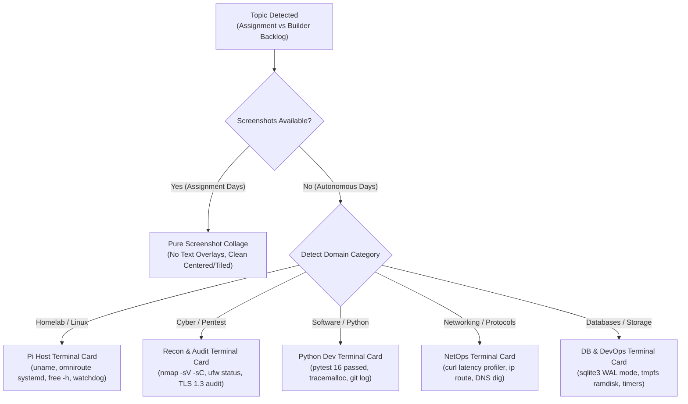

# 🚀 Autonomous LinkedIn Growth & Proof-of-Work Engine (v3.3 God-Mode)

> **Designed for Arush Sengar**  
> *1st-Year BCA Cyber Security Student @ Galgotias University*  
> *Cyber Security Intern @ Cyber Secured India & SafeSkillz*  
> *Homelab Engineer & Builder Learning in Public*

---

## 1. Executive Summary & Root Cause Analysis

### Why Previous Posts Failed & What Was Upgraded
1. **The Stock Photo & AI Art Trap (Eliminated)**:
   - *Previous*: Used generic Wikimedia Commons museum cutaway engines or 3D neon cyberpunk fantasy renders that screamed "pure AI".
   - *Upgraded (v3.3)*:
     - **Assignment Days**: Pure multi-screenshot collage of real lab proof (`assignment_media/`) with zero synthetic text overlays or artificial headers.
     - **Autonomous Builder Days**: Dynamically generated **Authentic Dark-Mode Terminal Proof Cards** (1200x1200) tailored to the topic domain (Homelab, Python, Networking, Databases, Pentesting) with real commands, live stats, macOS window traffic lights, and active bash cursors. Zero AI fantasy art.
2. **Sterile AI Copywriting (Humanized)**:
   - *Previous*: Full of ChatGPT corporate buzzwords ("without breaking a sweat", "rock-solid", "game-changer", "delve into"), rocket openers (🚀), and diamond bullets (🔹).
   - *Upgraded (v3.3)*: 100% human, candid student builder voice (120–180 words). Real friction hooks, diagnosis under the hood, numbered 1-2-3 actionable fixes, real numbers, and natural peer discussion questions.
3. **Multi-Domain Topic Scope Expansion**:
   - Expanded beyond just Cyber Security, AI, and Cloud into:
     - **Software Engineering & Python Internals** (`tracemalloc`, memory leaks, GIL, async vs multiprocessing)
     - **Databases & Storage** (SQLite WAL mode tuning, LRU caching, tmpfs ramdisks)
     - **Computer Networking & Protocols** (DNS latency, split-brain resolution, TCP handshake & TIME-WAIT)
     - **Linux & Kernel Internals** (OOM killer mitigation, zram-tools, cgroups, systemd timers)
     - **Student Builder Realities** (1st-year BCA journey at Galgotias University, shipping MVPs, learning curves)

---

## 2. Dynamic Visual Engine Architecture

The visual engine ([`linkedin_collage_generator.py`](file:///c:/Users/Arush/OneDrive/Documents/omni/hermes/scripts/linkedin_collage_generator.py)) operates in two distinct, high-credibility modes:



---

## 3. Core Engine Architecture

The upgraded architecture consists of four modular components running on the Raspberry Pi 4 (`192.168.0.100`):

```
/home/arush/
├── linkedin_daily_post.py          <-- Master orchestration & Composio publisher
├── linkedin_activity_detector.py   <-- Assignment parser, DOCX extractor, and multi-domain backlog rotation
├── linkedin_copywriter.py          <-- OmniRoute LLM humanized copywriting engine (100% candid builder tone)
├── linkedin_collage_generator.py   <-- Pillow-based 1200x1200 pure collage & dynamic terminal card renderer
└── assignment_media/               <-- High-resolution extracted assignment screenshots
```

### Component Breakdown

| Component | File | Responsibilities |
| :--- | :--- | :--- |
| **Detector** | [`linkedin_activity_detector.py`](file:///c:/Users/Arush/OneDrive/Documents/omni/hermes/scripts/linkedin_activity_detector.py) | Scans `~/assignments_archive/documents/*.docx`, user notes (`~/posts/notes.md`), and rotates across 10 diverse engineering topics spanning Linux, Python, Networking, Databases, Pentesting, and Hackathons. |
| **Copywriter** | [`linkedin_copywriter.py`](file:///c:/Users/Arush/OneDrive/Documents/omni/hermes/scripts/linkedin_copywriter.py) | Connects to local OmniRoute AI Gateway (`http://localhost:20128/v1`). Enforces 100% human student builder voice, rejects AI clichés and rocket emojis, formats numbered 1-2-3 fixes, and targets 120–180 words. |
| **Visual Engine** | [`linkedin_collage_generator.py`](file:///c:/Users/Arush/OneDrive/Documents/omni/hermes/scripts/linkedin_collage_generator.py) | High-performance Pillow rendering. Creates 1200x1200 high-res collages without synthetic text overlays, or renders dynamic dark terminal proof cards matching the topic category. |
| **Master Poster** | [`linkedin_daily_post.py`](file:///c:/Users/Arush/OneDrive/Documents/omni/hermes/scripts/linkedin_daily_post.py) | Coordinates the end-to-end flow. Publishes via Composio CLI (`LINKEDIN_CREATE_LINKED_IN_POST`), falls back to Playwright, and logs records to `~/posts/daily/` and `~/.hermes/linkedin_daily/daily_learnings.json`. |

---

## 4. Real Assignment Portfolio Ready for Posting

All authentic lab screenshots have been extracted and mapped:

| Assignment | Topic | Platform | Screenshots Extracted | Key Modules |
| :---: | :--- | :--- | :---: | :--- |
| **06** | Nmap & Metasploit | TryHackMe | 3 screenshots (1080p) | Nmap Part 1, Further Nmap, Metasploit Intro |
| **07** | Linux Privilege Escalation & Basic Pentesting | TryHackMe | 3 screenshots (1080p) | Basic Pentesting, Linux PrivEsc, Linux Strength Training |
| **10** | iOS Pentesting | OWASP MAS | 1 screenshot | iOS UnCrackable Level 1, Frida jailbreak bypass |
| **11** | OSINT and Dark Web Recon | HackTheBox / TryHackMe | 3 screenshots (1080p) | OSINT Corporate Recon, Sakura Room |
| **12** | Cloud Security: Fundamentals & Defense | Microsoft Learn | 7 screenshots (1080p) | Azure NSG configuration, Inbound/Outbound rules |
| **Special** | Lakera AI Agent Breaker | Lakera AI | 3 screenshots (1080p) | Prompt Injection, System Prompt Extraction |

---

## 5. Verification & Testing Commands

To test or trigger the system on the Raspberry Pi:

```bash
# 1. Full dry-run (generates post copy and collage/terminal image without publishing)
python3 ~/linkedin_daily_post.py --dry-run

# 2. Force a specific assignment (e.g. Assignment 7)
python3 ~/linkedin_daily_post.py --dry-run --assignment 7

# 3. Force a specific multi-domain builder topic
python3 ~/linkedin_daily_post.py --dry-run --topic "Debugging Silent Memory Leaks in Python Daemons with tracemalloc"

# 4. Generate post preview
python3 ~/linkedin_daily_post.py --preview

# 5. Live publish (triggers Composio LinkedIn post with image)
python3 ~/linkedin_daily_post.py
```

---

## 6. Daily Autonomous Schedule & Hermes Integration

- **Hermes Cron Job**: `35a18463b414`
- **Schedule**: Every day at **10:00 AM IST** (`every day at 10am`)
- **Delivery Target**: `local` (clean execution without Telegram delivery errors)
- **Attached Skill**: `linkedin-daily-post` (v3.3.0 God-Mode in `~/.hermes/skills/social-media/linkedin-daily-post/`)
- **Hermes Memory**: Trained and persisted in `~/.hermes/memories/MEMORY.md`
- **Archive Path**: `/home/arush/posts/daily/YYYYMMDD_HHMM.md`
- **Learnings History**: `/home/arush/.hermes/linkedin_daily/daily_learnings.json`
