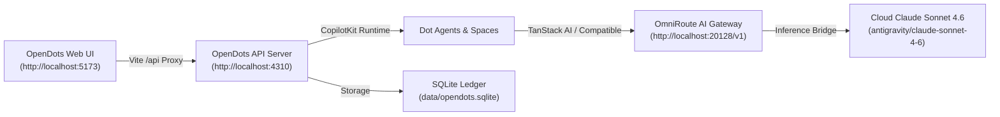

# OpenDots + OmniRoute Complete PC Installation & Integration Guide

OpenDots by CopilotKit is now installed and fully integrated with your local **OmniRoute AI Gateway** on your PC.

---

## 1. System Architecture



---

## 2. What Has Been Installed & Configured

| Component | Path / Detail | Status |
| :--- | :--- | :--- |
| **Node.js Runtime** | `C:\Program Files\nodejs\node.exe` (v26.13.1 LTS) | Installed |
| **npm Package Manager** | `C:\Program Files\nodejs\npm.cmd` (v11.20.0) | Installed |
| **OpenDots Workspace** | `c:\Users\Arush\OneDrive\Documents\omni\OpenDots` | Cloned & Built (`npm run build` Verified) |
| **OmniRoute Gateway** | `http://localhost:20128/v1` | Configured |
| **Primary Cloud Model** | `antigravity/claude-sonnet-4-6` (or `hermes-brain`) | Integrated in `.env` |
| **1-Click Launchers** | `run_opendots.bat` and `run_opendots.ps1` | Ready |

---

## 3. Configuration Details (`OpenDots/.env`)

```ini
HOST=127.0.0.1
PORT=4310
DATABASE_PATH=data/opendots.sqlite
OWNER_ID=arush-sengar
APP_ORIGIN=http://localhost:5173,http://127.0.0.1:5173

# OmniRoute AI Gateway Model Configuration
OPENAI_API_KEY=sk-971230e546e14a3e-23822a-06e1aa8d
OPENAI_BASE_URL=http://localhost:20128/v1
OPENAI_MODEL=antigravity/claude-sonnet-4-6

# Research & Privacy
WEB_SEARCH_PROVIDER=parallel
DO_NOT_TRACK=1
COPILOTKIT_TELEMETRY_DISABLED=true
```

---

## 4. How to Launch & Use

### Method A: 1-Click Batch Launcher (Recommended)
Double-click [`run_opendots.bat`](file:///c:/Users/Arush/OneDrive/Documents/omni/run_opendots.bat) in the project directory. It will:
1. Verify OmniRoute is running on port 20128 (starting it if needed).
2. Launch the OpenDots server.
3. Automatically launch your browser at [http://localhost:5173](http://localhost:5173).

### Method B: PowerShell Launcher
```powershell
.\run_opendots.ps1
```

### Method C: Manual Terminal Launch
```bash
cd OpenDots
npm run dev
```

---

## 5. Linking CopilotKit Intelligence (1-Time Setup)

To allow Dots to store conversations across sessions:
1. Open PowerShell in `OpenDots`:
   ```powershell
   cd OpenDots
   npx copilotkit@latest login
   npx copilotkit@latest project select
   ```
2. This will bind your free CopilotKit project key into `.env`.

---

## 6. Verification Suite

Run our automated verification script anytime:
```bash
python scripts/test_omniroute_opendots.py
```
