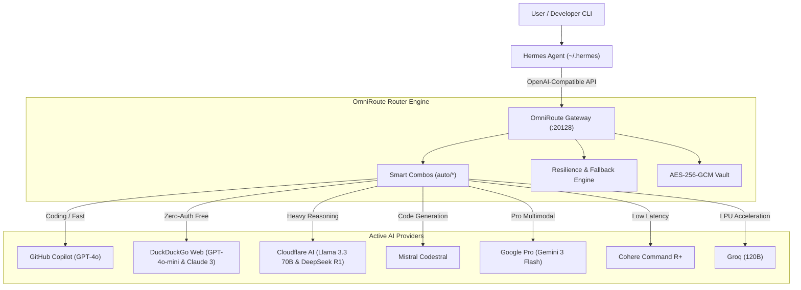

# OmniRoute AI Gateway & Hermes Integration System

A high-availability, multi-provider AI routing infrastructure connecting **OmniRoute Gateway** (running on Raspberry Pi 4 Debian arm64) with **Hermes Autonomous Agent** and downstream developer tools.

Provides intelligent fallbacks, latency optimization, load balancing, zero-cost routing, and clean-room web executors across 12+ providers and 1,000+ registered models.

---

## 🏗️ Architecture Overview



---

## ⚡ Active Providers & Status Matrix

| Provider / Model | Route / Model ID | Status | Cost Tier | Best For |
| :--- | :--- | :--- | :--- | :--- |
| **Hermes Free Coding** | `auto/coding:free` | **200 OK** | Free | Default Hermes agent execution |
| **Smart Coding Combo** | `auto/best-coding` | **200 OK** | Free | Complex code generation with reasoning |
| **Smart Chat Combo** | `auto/best-chat` | **200 OK** | Free | General chat & multi-turn dialogs |
| **Smart Reasoning** | `auto/best-reasoning` | **200 OK** | Free | Chain-of-thought analysis |
| **GitHub Copilot** | `github/gpt-4o` | **200 OK** | Included | Official GPT-4o high-precision |
| **DuckDuckGo Web** | `duckduckgo-web/gpt-4o-mini` | **200 OK** | Free | Fast responses (~1.3s latency) |
| **DuckDuckGo Web** | `duckduckgo-web/claude-3-haiku` | **200 OK** | Free | Zero-auth Anthropic Claude 3 |
| **Cloudflare Playground** | `cloudflare-playground/...` | **200 OK** | Free | Llama 3.3 70B & DeepSeek R1 |
| **Antigravity Pro** | `antigravity/gemini-3-flash` | **200 OK** | Pro OAuth | Google Gemini 3 Flash & Pro |
| **Mistral Codestral** | `codestral/codestral-latest` | **200 OK** | API Key | Code completion and refactoring |
| **Cohere Command** | `cohere/command-r-plus-08-2024`| **200 OK** | API Key | Ultra-fast enterprise reasoning (<850ms) |
| **Groq LPU** | `groq/openai/gpt-oss-120b` | **200 OK** | API Key | Sub-second LPU throughput (<750ms) |

---

## 🚀 Quick Setup & Deployment

### 1. Clone & Bootstrap on Raspberry Pi / Linux Server

```bash
# Clone this repository
git clone <YOUR_GITHUB_REPO_URL> omni
cd omni

# Run the automated deployment script
chmod +x scripts/*.sh
./scripts/setup_pi_omniroute.sh
```

The script will automatically:
- Install required system packages (`chromium`, `sqlite3`, `curl`).
- Configure environment variables and Chromium driver paths.
- Apply Playwright clean-room security configurations.
- Verify server health on port `20128`.

---

### 2. Configure Hermes Agent

Point your Hermes agent at OmniRoute by updating `~/.hermes/config.yaml`:

```yaml
model:
  provider: custom:omni
  base_url: http://localhost:20128/v1
  cloud_provider: local

custom_providers:
  omni:
    base_url: http://localhost:20128/v1
    api_key_env: HERMES_CUSTOM_LOCALHOST_20128_API_KEY
    model: auto/coding:free
    models_discovered: true
```

Set the API key in `~/.hermes/.env`:
```bash
HERMES_CUSTOM_LOCALHOST_20128_API_KEY=sk-971230e546e14a3e-23822a-06e1aa8d
```

---

## 🧪 Verification & Health Checks

Run the verification suite from your workstation or Pi:

```bash
# Run complete test suite across all 12+ providers and combos
python scripts/verify_all_providers.py --host http://192.168.0.100:20128

# Test Hermes-specific bridge
python hermes/hermes_omniroute_bridge.py http://192.168.0.100:20128
```

---

## 📁 Repository Structure

```
omni/
├── README.md                      # Complete system documentation & architecture
├── .gitignore                     # Protects credentials, SQLite DBs, and session tokens
├── config/
│   ├── omniroute.env.example      # Master OmniRoute environment template
│   ├── hermes_config.yaml.example # Hermes Agent configuration template
│   └── provider_topology.json     # Machine-readable provider topology & combos
├── scripts/
│   ├── verify_all_providers.py    # Live latency & response benchmark suite
│   ├── setup_pi_omniroute.sh      # 1-Click setup script for Raspberry Pi
│   ├── patch_playwright_security.sh # CSP bypass & headless browser patch
│   └── sync_credentials.py       # AES-256-GCM credential vault helper
└── hermes/
    └── hermes_omniroute_bridge.py # Hermes Agent connection verification tool
```

---

## 🔒 Security Best Practices

- **Never commit `.env` or `storage.sqlite`** to GitHub. The included `.gitignore` automatically excludes them.
- All provider keys inside `storage.sqlite` are protected with **AES-256-GCM** using `STORAGE_ENCRYPTION_KEY`.
- For fresh server migrations, copy your `STORAGE_ENCRYPTION_KEY` into `~/.omniroute/.env` before restoring database backups.

---

## 🛠️ Maintenance Commands

```bash
# View live logs on Pi
omniroute logs --lines 50

# Restart router
omniroute restart

# List all configured providers
omniroute providers list
```

