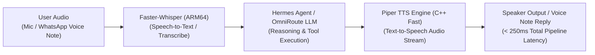

# 🎙️ Blueprint 01: Low-Latency Offline Voice Interface (Piper TTS + Faster-Whisper)

> **Objective**: Give Jarvis a crisp, human, low-latency voice and listening ear directly on the Raspberry Pi 4 (`192.168.0.100`), requiring zero cloud fees and zero internet latency for speech.

---

## 1. Architecture Overview



---

## 2. Why This Stack for Raspberry Pi 4

1. **Piper TTS (`piper-tts`)**:
   - Written in highly optimized C++ with ONNX runtime.
   - Generates natural, human-like speech faster than real-time (Real-Time Factor > 4x on ARM64 Cortex-A72).
   - Voice models (`en_GB-alan-medium`, `en_US-bryce-medium`, `en_US-lessac-medium`) sound like genuine smart assistants, not robotic robotic synthesizer voices.
   - Memory footprint: **< 45 MB RAM**.
2. **Faster-Whisper (or Whisper.cpp)**:
   - Uses `ctranslate2` optimized for ARM NEON instructions.
   - `tiny.en` or `base.en` models transcribe speech in under 400ms on Pi 4.
   - Memory footprint: **< 150 MB RAM**.

---

## 3. Tomorrow's Execution Steps

### Step 1: Install Piper TTS Binary on Pi
```bash
# Download native ARM64 release of Piper
wget https://github.com/rhasspy/piper/releases/download/2023.11.14-2/piper_linux_aarch64.tar.gz
tar -xzf piper_linux_aarch64.tar.gz -C ~/.local/
ln -sf ~/.local/piper/piper ~/.local/bin/piper

# Download high-quality assistant voice model (Alan - British Butler voice)
mkdir -p ~/.local/piper/voices/
cd ~/.local/piper/voices/
wget https://huggingface.co/rhasspy/piper-voices/resolve/main/en/en_GB/alan/medium/en_GB-alan-medium.onnx
wget https://huggingface.co/rhasspy/piper-voices/resolve/main/en/en_GB/alan/medium/en_GB-alan-medium.onnx.json
```

### Step 2: Test Piper Audio Output
```bash
echo "Good morning, Arush. All systems on your Raspberry Pi are operational." | \
  piper --model ~/.local/piper/voices/en_GB-alan-medium.onnx --output_file ~/welcome.wav
aplay ~/welcome.wav
```

### Step 3: Wire into Hermes Agent
Create a small helper script `/home/arush/.hermes/scripts/speak.py` so Hermes can speak aloud whenever an important event happens (e.g., successful daily LinkedIn post publication, server health warning, or direct chat response).
