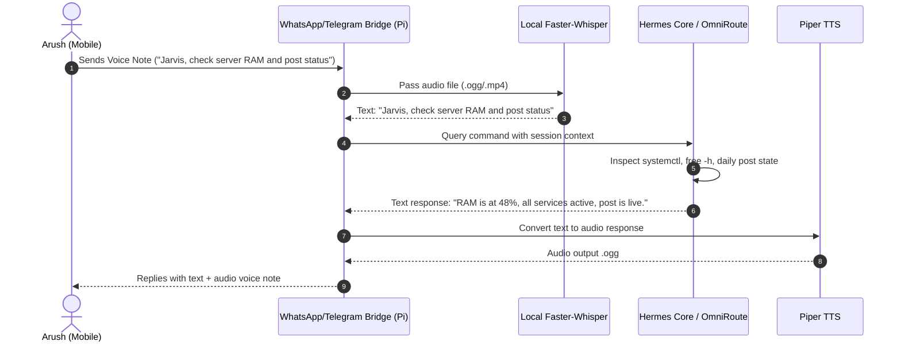

# 📱 Blueprint 02: Bi-Directional WhatsApp & Telegram Auto-Pilot

> **Objective**: Turn Arush's phone into a 24/7 direct communication hotline with Jarvis via WhatsApp and Telegram, supporting text and voice notes.

---

## 1. Architecture Overview

---

## 2. Existing Foundation on the Pi

Notice in today's process audit:
- The Pi already has `/home/arush/.hermes/hermes-agent/scripts/whatsapp-bridge/bridge.js` running on Node.js.
- Session directory: `/home/arush/.hermes/platforms/whatsapp/session`.
- Telegram bot adapter is integrated in Hermes core.

---

## 3. Tomorrow's Implementation Steps

1. **Telegram Webhook / Long-Polling Fix**:
   - The Telegram bot previously failed with `Forbidden: bot was blocked by the user`.
   - Action: Unblock the bot or generate a fresh bot token via `@BotFather`, update `~/.hermes/.env` with `TELEGRAM_BOT_TOKEN`, and start a dedicated chat.
2. **Voice Note Auto-Transcribe Hook**:
   - Add a small event listener in `bridge.js` that checks for `message.hasMedia && message.type === 'ptt'` (Push-To-Talk voice note).
   - Automatically runs `faster-whisper` on the saved audio and forwards the transcribed command to Hermes.
3. **Voice Note Synthesis Reply**:
   - When Arush talks via voice, Jarvis replies with a voice note generated by Piper TTS.

