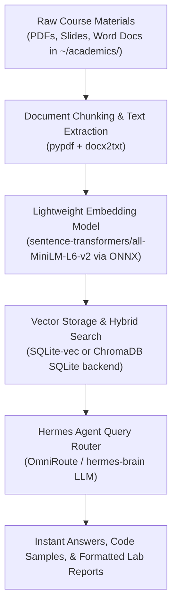

# 📚 Blueprint 03: Galgotias University BCA Academic Vault & Local RAG

> **Objective**: Turn Jarvis into Arush's personal academic advisor, exam coach, and lab report generator by indexing his BCA Cyber Security syllabus, lecture notes, textbook PDFs, and lab assignments using a local, lightweight vector database.

---

## 1. Why a Local Academic Vault?

- **Zero Hallucination**: When Arush asks "What are the steps for Experiment 8?" or "Explain the difference between TCP Reno and Tahoe from our syllabus", Jarvis answers strictly from Galgotias course materials.
- **Automated Lab Report Drafting**: Pre-populates documents with Arush's exact header format:
  ```
  Experiment – N
  Name – Arush Sengar
  Roll no – 26SCAT1100020
  Section – 11
  Aim: <Extracted Aim>
  ```
- **Instant Exam Prep & Flashcards**: Converts lecture slide PDFs into quiz questions and quick cheat sheets before semester exams.

---

## 2. Technical Stack for Raspberry Pi 4



---

## 3. Tomorrow's Execution Plan

1. Create directory structure: `/home/arush/academics/{semester_1,semester_2}/notes/`
2. Install `sqlite-vec` or `chromadb`:
   ```bash
   pip install chromadb pypdf python-docx
   ```
3. Build `academic_vault.py` indexing CLI:
   - Command: `python3 ~/academic_vault.py --index ~/academics/`
   - Command: `python3 ~/academic_vault.py --ask "Explain SUID bit permissions"`
4. Add Hermes skill `academic-vault` to allow natural query answering during study sessions.
