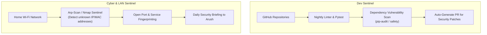

# 🛡️ Blueprint 04: Autonomous Dev & Cyber Sentinel

> **Objective**: Jarvis acts as an autonomous 24/7 guardian — auditing Arush's GitHub repositories, running automated security tests, scanning the home Wi-Fi network for rogue devices, and alerting Arush to CVEs.

---

## 1. Capabilities Overview

---

## 2. Dev Sentinel Pipeline

1. **Auto-Pull & Test**:
   - Every midnight at 01:00 AM, Jarvis clones/pulls Arush's key projects.
   - Runs test suites (`pytest`, `npm test`) and syntax checkers.
   - If tests fail, logs the stack trace and drafts a root-cause explanation.
2. **Dependency Audit**:
   - Checks `requirements.txt` and `package.json` for known vulnerabilities using `pip-audit`.

---

## 3. Cyber & LAN Sentinel Pipeline

1. **Unknown Device Alert**:
   - Scans local subnet (`192.168.0.0/24`) every 4 hours via `arp-scan`.
   - Maintains a whitelist of known family devices (Arush PC, Pi, Arush Phone, TV, Router).
   - If a new MAC address connects, Jarvis logs an alert:
     `[SECURITY NOTICE] New device detected on LAN: 192.168.0.145 (MAC: 48:2c:67:... Vendor: Espressif)`
2. **Homelab Perimeter Check**:
   - Audits UFW firewall rules on the Pi: ensures no external ports are opened accidentally without Cloudflare tunnel protection.

