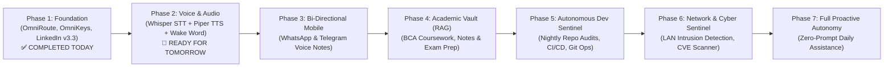

# 🤖 Project Jarvis: Transforming Hermes into Arush's Ultimate Personal AI

> **Vision**: Evolve the Raspberry Pi 4 (`192.168.0.100`) and Hermes Agent from a reactive bot into an autonomous, voice-enabled, proactive personal operating system — a true real-world **Jarvis**.  
> **Host**: Raspberry Pi 4 Model B (Debian 13 trixie, 4GB RAM, 24/7 Online via Cloudflare Tunnel)  
> **Master**: Arush Sengar (1st-Year BCA Cyber Security @ Galgotias University)

---

## 🗺️ Master Evolution Roadmap (7-Phase Blueprint)

---

## 📋 What We Have Prepared for Tomorrow

Inside this `jarvis_roadmap/` directory, we have researched and documented four turnkey implementation blueprints ready to execute tomorrow:

| Blueprint | File | What It Unlocks |
| :--- | :--- | :--- |
| **1. Voice Interface** | [`01_VOICE_INTERFACE_PIPER_WHISPER.md`](file:///c:/Users/Arush/OneDrive/Documents/omni/jarvis_roadmap/01_VOICE_INTERFACE_PIPER_WHISPER.md) | Local offline Text-to-Speech (Piper TTS, <150ms latency) + Whisper Speech-to-Text so Jarvis can speak and listen in real-time. |
| **2. Mobile Auto-Pilot** | [`02_WHATSAPP_TELEGRAM_AUTOPILOT.md`](file:///c:/Users/Arush/OneDrive/Documents/omni/jarvis_roadmap/02_WHATSAPP_TELEGRAM_AUTOPILOT.md) | Bi-directional voice-note support on WhatsApp/Telegram: send a voice note, get smart action executed and voice reply. |
| **3. Academic Vault (RAG)** | [`03_PERSONAL_KNOWLEDGE_VAULT_RAG.md`](file:///c:/Users/Arush/OneDrive/Documents/omni/jarvis_roadmap/03_PERSONAL_KNOWLEDGE_VAULT_RAG.md) | Local vector database indexing all Galgotias University BCA notes, assignment PDFs, and code for instant Q&A and exam prep. |
| **4. Autonomous Dev Sentinel** | [`04_AUTONOMOUS_DEV_SENTINEL.md`](file:///c:/Users/Arush/OneDrive/Documents/omni/jarvis_roadmap/04_AUTONOMOUS_DEV_SENTINEL.md) | Nightly GitHub repo auditing, test suites running, LAN Wi-Fi intrusion detection, and automatic threat intelligence. |
| **Master Archive** | [`TODAY_WORK_ARCHIVE_AND_LOG.md`](file:///c:/Users/Arush/OneDrive/Documents/omni/jarvis_roadmap/TODAY_WORK_ARCHIVE_AND_LOG.md) | Comprehensive engineering record of everything built, configured, and verified today so context is permanently preserved. |

---

## ⚡ Recommended Immediate Next Step for Tomorrow

**Priority 1: Offline Local Voice Engine (Piper TTS + Faster-Whisper)**
- Allows Hermes to talk back with an ultra-realistic, low-latency natural human voice directly on the Pi without consuming cloud API credits.
- Can be triggered directly from CLI or mobile chat.
